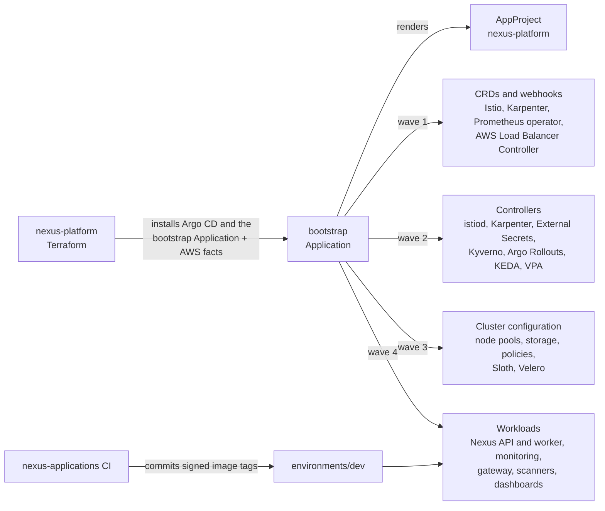

# Nexus GitOps

This repository is the source of truth for everything that runs in the Nexus
Kubernetes clusters. Each environment and region has its own EKS cluster, and
the Argo CD instance in every cluster reconciles this repository.

The split with `nexus-platform` follows the GitOps Bridge pattern: Terraform
creates the AWS resources, installs Argo CD, and hands the cluster one root
Application named `bootstrap` together with the facts it knows about AWS.
Everything that runs inside Kubernetes, including every add-on, is defined
here.

The [architecture decision records](docs/adr/README.md) explain why each part
is built the way it is.

## Documentation

| Page | Contents |
| --- | --- |
| [Architecture](docs/architecture.md) | Repository structure, how Argo CD deploys a cluster, sync waves, cluster facts, where each value lives |
| [Workloads](docs/workloads.md) | The Nexus applications and the platform charts |
| [Operations](docs/operations.md) | Deployments, common changes, backups, dashboards and tools |
| [Observability](docs/observability.md) | Metrics, logs, traces, profiles, SLOs, and alerts |
| [Security](docs/security.md) | Admission policies, image scanning, mutual TLS, and secrets |
| [Validation](docs/validation.md) | Checks that run before a change reaches a cluster |
| [Runbooks](docs/runbooks/README.md) | What to do when an alert fires |
| [Decision records](docs/adr/README.md) | Why each major choice was made |

## Related repositories

- `nexus-platform`: the AWS infrastructure, which installs Argo CD and hands
  it the cluster facts.
- `nexus-applications`: the API and worker source code; its `Deploy` workflow
  writes image tags to `environments/`.
