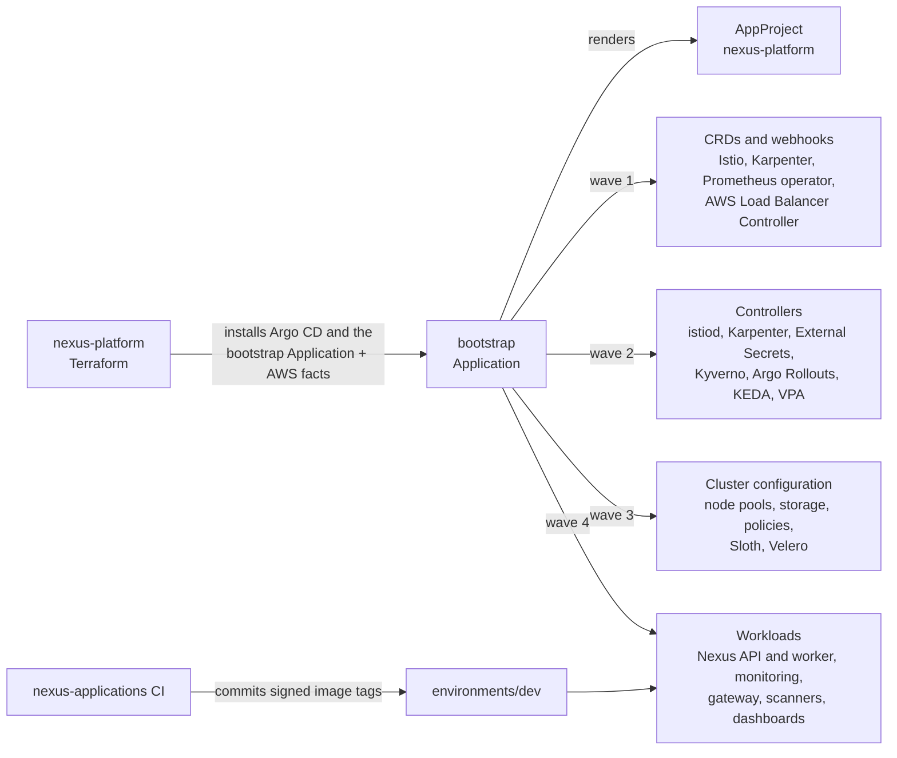
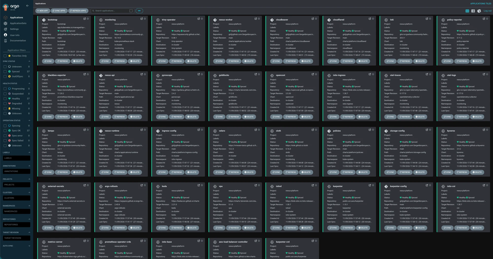
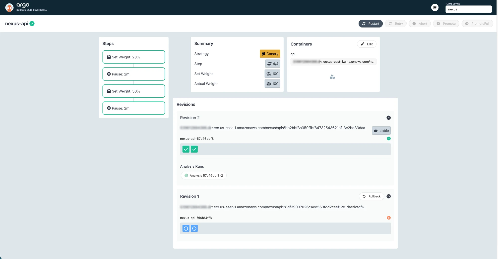
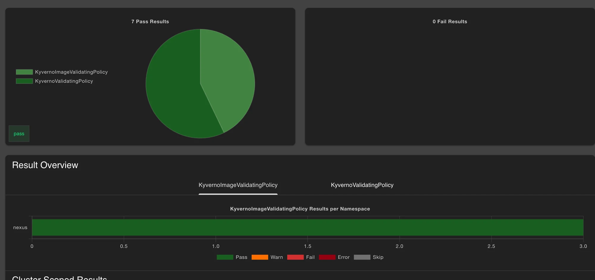
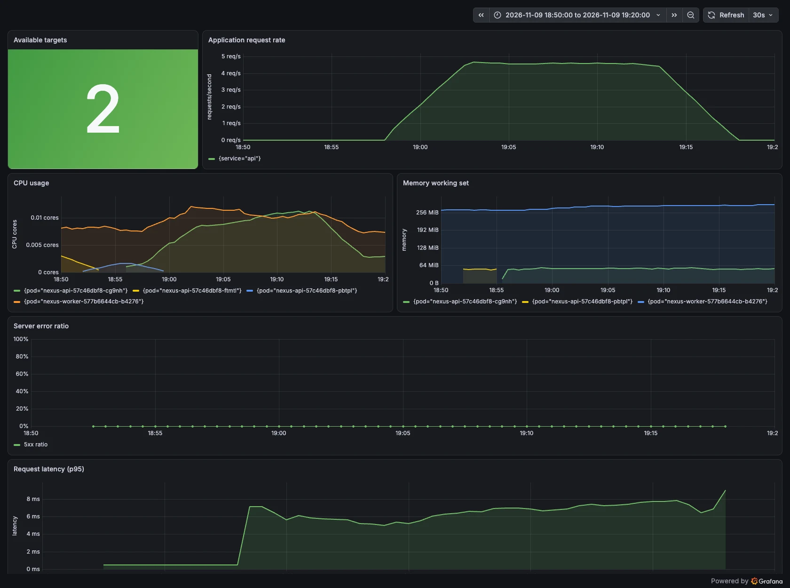

# Nexus GitOps

The desired state of every Nexus Kubernetes cluster: service mesh, autoscaling,
admission policy, observability, backups, and the Nexus services themselves.
Argo CD in each cluster reconciles this repository continuously; nothing is
applied by hand, and every change is a reviewed commit.

## Nexus

Nexus is a production-style platform I designed and built end to end: AWS
infrastructure, a GitOps-managed Kubernetes platform, and two services that
exercise it. Ownership is split across three repositories:

| Repository | Responsibility |
| --- | --- |
| [nexus-platform](https://github.com/SergeAbroyan/nexus-platform) | Account-wide resources, networking, EKS, data services, edge, Argo CD installation |
| **nexus-gitops** | Every workload and add-on inside the clusters, reconciled by Argo CD |
| [nexus-applications](https://github.com/SergeAbroyan/nexus-applications) | Go API, Java worker, and the supply chain that builds, signs, and promotes them |

Environments are ephemeral: a rebuild of the infrastructure brings every
Application in this repository back without manual steps. A walkthrough with
screenshots is on
[sergeabroyan.com/projects/nexus](https://sergeabroyan.com/projects/nexus/).

## Architecture

`nexus-platform` installs Argo CD and creates exactly one Application,
`bootstrap`, passing it the facts Terraform knows about the environment: role
ARNs, queue URLs, database endpoints, the hostname, the CI signing identity.
The `bootstrap` Helm chart validates those facts against a JSON schema and
renders the 37 Applications of the platform, ordered into four sync waves so
that CRDs precede the controllers that serve them and controllers precede their
configuration. No account-specific value is committed here.



## Platform components

| Area | Components |
| --- | --- |
| Traffic | Istio 1.30 with sidecars, strict mutual TLS in the Nexus namespace, an ingress gateway behind an internal NLB |
| Capacity | Karpenter 1.15 node pools for system, general, and Spot workloads; metrics-server; VPA with Goldilocks recommendations |
| Delivery | Argo Rollouts canaries with Prometheus analysis |
| Policy | Kyverno with Policy Reporter, Pod Security `restricted` on application namespaces |
| Secrets | External Secrets reading AWS Secrets Manager through EKS Pod Identity |
| Observability | kube-prometheus-stack, Loki, Tempo, Pyroscope, OpenTelemetry collectors, Sloth, blackbox exporter |
| Security scanning | Trivy Operator for the images that are actually running |
| Cost | OpenCost |
| Backup | Velero, scheduled nightly |
| Access | `cloudflared` for the Cloudflare Tunnel, CloudBeaver for database administration |

Exact chart versions are pinned in [`bootstrap/values.yaml`](bootstrap/values.yaml).

## Delivery

A change to a cluster is a pull request to this repository. After merge, Argo
CD reconciles it within minutes and self-heals any drift.

Service releases follow the same path. CI in `nexus-applications` builds and
signs an image once, then commits its tag to `environments/dev/`; the `Deploy`
workflow in that repository promotes the same tag to `staging` and
`production`, which requires an approval.

The API rolls out as a canary through Istio traffic splitting: 20% of requests
for two minutes, then 50% for two minutes, then full promotion. An analysis
queries Prometheus every minute and aborts the rollout, returning all traffic to
the stable version, when the success rate stays below 95% beyond the configured
failure limit.

## Policy and security

- **Signed images only.** A Kyverno image validating policy admits a Nexus image
  only with a keyless cosign signature issued to the `nexus-applications` CI
  workflow on `main`; Kyverno reads signatures from ECR with its own Pod
  Identity. Background scans re-verify running pods.
- **Workload hardening.** Nexus workloads must run as non-root with the
  `RuntimeDefault` seccomp profile, no privilege escalation, no Linux
  capabilities, and CPU and memory requests and limits. Pod Security
  `restricted` enforces the same baseline at namespace level.
- **Zero-trust networking.** Istio peer authentication is `STRICT` for the
  Nexus services; each sidecar merges the application's metrics on its own
  port, so Prometheus scrapes them without weakening mutual TLS.
- **No secrets in Git.** Every credential is an `ExternalSecret` resolved at
  runtime from AWS Secrets Manager.

## Reliability and scaling

- The API scales on CPU and memory through a horizontal autoscaler; KEDA scales
  the worker on SQS queue depth, one replica per five messages, and on CPU.
- In staging and production, disruption budgets keep replicas serving during
  node replacement; Karpenter consolidates underused nodes and replaces Spot
  capacity ahead of interruption.
- Velero backs up the application, database administration, and monitoring
  namespaces every night; database backups are handled by AWS in
  `nexus-platform`.

## Observability

Metrics, logs, traces, and profiles share one Grafana: Prometheus for metrics,
Loki for logs shipped by an OpenTelemetry DaemonSet, Tempo for traces through an
OpenTelemetry gateway, and Pyroscope for continuous profiling. Two dashboards
ship with the services: an overview of availability, rate, latency, and
resources, and an AWS view of RDS, ElastiCache, and SQS from CloudWatch.

The API has two service-level objectives over 30 days: 99.5% availability and
99% of requests under 500 ms. Sloth turns them into multi-window burn-rate
alerts, paging on fast burn and opening a ticket on slow burn. A blackbox probe
checks the public address through CloudFront every minute, including
certificate expiry. Alertmanager routes alerts to email through SNS, alerts
link to their [runbooks](docs/runbooks/README.md), and eight
[drills](docs/runbooks/drills.md) rehearse the failure modes that matter.

## Key decisions

| Decision | Record |
| --- | --- |
| Terraform hands the cluster to Argo CD through one root Application | [ADR 0001](docs/adr/0001-gitops-bridge.md) |
| A Helm bootstrap chart renders every Application instead of ApplicationSets | [ADR 0002](docs/adr/0002-bootstrap-chart-over-applicationsets.md) |
| Canary releases with Argo Rollouts and Istio | [ADR 0003](docs/adr/0003-canary-releases-with-argo-rollouts.md) |
| Kyverno for workload security and image signatures | [ADR 0004](docs/adr/0004-kyverno-for-admission-policy.md) |
| SLO burn-rate alerts generated by Sloth | [ADR 0005](docs/adr/0005-slo-burn-rate-alerts.md) |
| Istio sidecars instead of ambient mode | [ADR 0006](docs/adr/0006-istio-sidecars-over-ambient.md) |
| KEDA scales the worker on queue depth | [ADR 0007](docs/adr/0007-queue-based-worker-scaling.md) |
| A GitHub workflow promotes releases instead of Kargo | [ADR 0008](docs/adr/0008-promotion-workflow-over-kargo.md) |

## Validation

Every pull request is verified without a cluster or AWS access. The workflow
scans the history with Gitleaks, renders the `bootstrap` chart for every
environment, then renders each resulting Application exactly as Argo CD would,
with the same chart versions and values files in the same order. It lints the
Nexus charts, checks that every values file is referenced, validates all output
with kubeconform against the Kubernetes 1.36 and CRD schemas, and runs the
Kyverno policies against the Nexus charts.

Render one environment locally:

```bash
helm template bootstrap bootstrap --namespace argocd \
  --values bootstrap/ci-values.yaml \
  --set cluster.environment=dev
```

## See it running

| | |
| --- | --- |
|  |  |
| 37 Applications synced and healthy after a rebuild | A canary promoted after five successful analysis runs |
|  |  |
| Every running pod passes the Kyverno policies | The service overview during a 15-minute load test |

## Using this repository

This repository is deployed by `nexus-platform`, not on its own: follow its
[Getting started](https://github.com/SergeAbroyan/nexus-platform/blob/main/docs/getting-started.md).
When forking the three repositories, keep their names; the infrastructure
derives repository addresses and CI identities from the GitHub owner and these
names.

## Repository layout

```text
bootstrap/        Root chart: add-on catalogue, versions, sync waves, and the
                  wiring of Terraform facts into each add-on
addons/           Values for third-party charts
charts/
├── base/         Library chart of shared, hardened resource templates
├── applications/ The API, the worker, and their runtime: mesh policy, alerts,
│                 dashboards, service-level objectives
└── platform/     First-party charts: node pools, storage, policies, ingress
                  gateway, Cloudflare Tunnel, CloudBeaver
environments/     Per-environment values, including the image tags in use
docs/             Architecture, operations, runbooks, decision records
```

## Documentation

| Page | Contents |
| --- | --- |
| [Architecture](docs/architecture.md) | Repository structure, how Argo CD deploys a cluster, sync waves, cluster facts, where each value lives |
| [Workloads](docs/workloads.md) | The Nexus applications and the platform charts |
| [Operations](docs/operations.md) | Deployments, common changes, backups, dashboards and tools |
| [Observability](docs/observability.md) | Metrics, logs, traces, profiles, SLOs, and alerts |
| [Security](docs/security.md) | Admission policies, image scanning, mutual TLS, and secrets |
| [Validation](docs/validation.md) | Checks that run before a change reaches a cluster |
| [Runbooks](docs/runbooks/README.md) | Response procedures for application, platform, and AWS alerts |
| [Decision records](docs/adr/README.md) | Context and consequences of each major choice |
