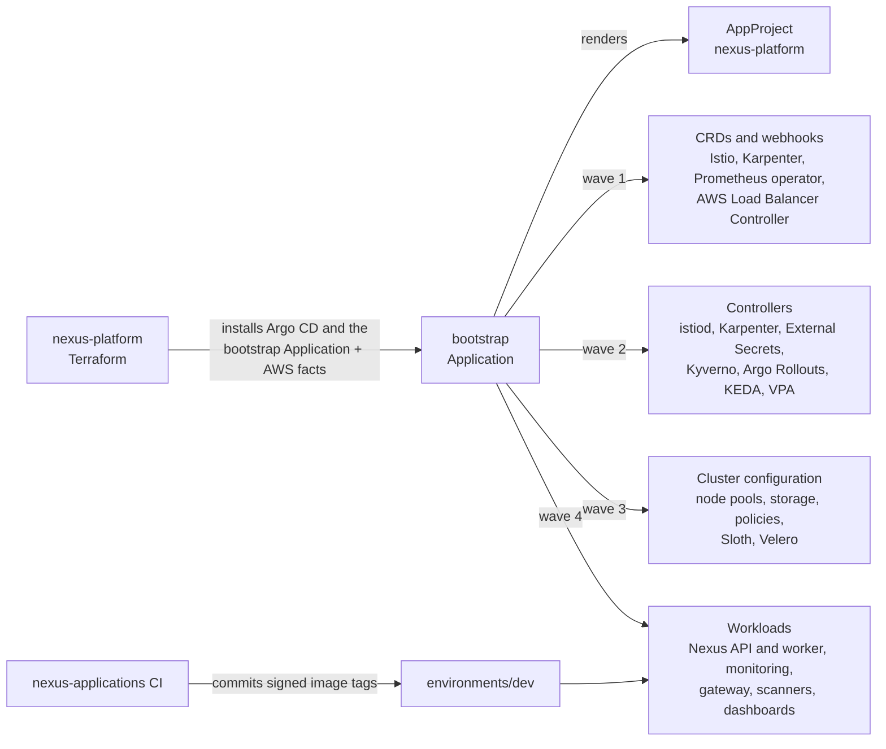

# Nexus GitOps

This repository is the source of truth for everything that runs in the Nexus
Kubernetes clusters. Each environment and region has its own EKS cluster, and
the Argo CD instance in every cluster reconciles this repository.

The split with `nexus-platform` follows the GitOps Bridge pattern: Terraform
creates the AWS resources, installs Argo CD, and hands the cluster one root
Application named `bootstrap` together with the facts it knows about AWS.
Everything that runs inside Kubernetes, including every add-on, is defined
here.



The [architecture decision records](docs/adr/README.md) explain why each part
is built the way it is.

## Repository structure

```text
bootstrap/                   Root chart: the AppProject and every Argo CD Application
├── values.yaml              Catalog of Applications: chart, version, namespace, sync wave
├── values.schema.json       Contract for the cluster facts that Terraform passes
├── ci-values.yaml           Stand-in cluster facts for CI
└── templates/
    ├── _wiring.tpl          Values that come from cluster facts or connect one Application to another
    ├── _helpers.tpl         Turns the catalog into Applications
    ├── applications.yaml
    └── project.yaml
addons/                      Values for third-party charts, one file per Application
charts/
├── base/                    Helm library: application, workload, namespace, and volume claim templates
├── applications/
│   ├── api/                 Go web page and REST API
│   ├── worker/              Java SQS worker
│   └── runtime/             Nexus namespace, mesh policy, alerts, and dashboards
└── platform/
    ├── cloudbeaver/         Internal database administration UI
    ├── ingress-config/      Istio gateway and load balancer binding
    ├── karpenter-config/    EC2 node class and node pools
    ├── policies/            Kyverno workload security and image signature policies
    └── storage-config/      Encrypted EBS StorageClass
environments/
├── global-values.yaml       Conventions shared by the Nexus applications
├── dev/                     Values that differ in DEV
├── staging/                 Values that differ in staging
└── production/              Values that differ in production
docs/runbooks/               Alert response procedures and resilience drills
docs/adr/                    Architecture decision records
.github/workflows/
├── validate.yaml            Secret scan and render, schema, and policy checks
└── promote.yaml             Approved promotion to staging and production
renovate.json                Dependency updates for charts, images, and actions
.pre-commit-config.yaml      Local checks before every commit
```

## How Argo CD deploys a cluster

This repository is private. Argo CD reads it over SSH with a read-only GitHub
deploy key that Terraform installs from Secrets Manager; the `nexus-platform`
README explains how to create it.

Terraform creates two Argo CD objects in each cluster:

- the `bootstrap` AppProject, which may only create Argo CD `Application` and
  `AppProject` objects in the Argo CD namespace;
- the `bootstrap` Application, which renders `bootstrap/` with the cluster
  facts as Helm values.

The `bootstrap` chart renders the `nexus-platform` AppProject and one
Application for every entry in `bootstrap/values.yaml`. Each entry belongs to
one of three groups, and the group decides where the chart and its values come
from:

| Group | Argo CD Application | Chart | Values files, in order |
| --- | --- | --- | --- |
| `addons` | `<key>` | `chart` and `version` from `repoURL` | `addons/<key>.yaml`, `environments/<env>/<key>-values.yaml` |
| `platform` | `<key>` | `charts/platform/<key>` | `environments/<env>/<key>-values.yaml` |
| `applications` | `nexus-<key>` | `charts/applications/<key>` | `environments/global-values.yaml`, `environments/<env>/<key>-values.yaml` |

The values from `_wiring.tpl` come last and win. Environment files exist only
where an environment differs, because every Application sets
`ignoreMissingValueFiles`. CI fails when a values file under `addons/` or
`environments/` is not loaded by any Application, so a misspelled file name
cannot be silently ignored.

### Sync waves

The root Application creates the Applications in waves and waits for every
Application in a wave to be healthy before it starts the next one. Terraform
configures the Argo CD health check for `Application` objects that makes this
wait possible.

| Wave | Applications | Why |
| --- | --- | --- |
| 0 | `nexus-platform` AppProject | Every Application belongs to it |
| 1 | `istio-base`, `karpenter-crd`, `prometheus-operator-crds`, `aws-load-balancer-controller` | CRDs, and the webhook that admits every Service |
| 2 | `istio-cni`, `istiod`, `karpenter`, `external-secrets`, `metrics-server`, `kyverno`, `argo-rollouts`, `keda`, `vpa` | Controllers that run on the managed `system` nodes |
| 3 | `karpenter-config`, `storage-config`, `policies`, `sloth`, `velero` | Node pools, storage and snapshot classes, admission policies, the SLO controller, and backups |
| 4 | Everything else | Pods start only after `istiod` can inject their sidecars |

The Prometheus operator CRDs have their own Application in the first wave,
and `kube-prometheus-stack` does not install them, so every add-on can ship a
`ServiceMonitor` or `PrometheusRule` regardless of its wave, and CRD upgrades
are applied by Argo CD instead of being skipped by Helm.

### Cluster facts

Terraform passes these values under `cluster`, and `values.schema.json` rejects
a missing, misspelled, or mistyped fact before anything renders:

| Fact | Used for |
| --- | --- |
| `environment` | Environment values files, alert and trace labels |
| `name`, `region`, `vpcId` | Karpenter, the AWS Load Balancer Controller, CloudWatch, Alertmanager, Secrets Manager |
| `gitops` | Repository and revision of every Application |
| `hostname`, `ingress` | Istio gateway port and host, load balancer target group |
| `ecrRegistry` | Image registry of the Nexus applications |
| `ebsKmsKeyArn`, `karpenter` | Node volume encryption, Karpenter node role and interruption queue |
| `serviceAccounts` | Namespace and name of every service account that has an AWS identity |
| `alertTopicArn`, `grafanaAdminSecretArn` | Alertmanager notifications, Grafana administrator password |
| `slackWebhookSecretName` | Secrets Manager secret that holds the Slack webhook URL |
| `backupBucket` | S3 bucket where Velero stores the cluster backups |
| `ciIdentity` | GitHub Actions workflow identity that must have signed every Nexus image |
| `database`, `cache`, `queue` | Connection settings of the API and worker |

An Application whose pods use an AWS identity runs in the namespace that
Terraform bound the identity to, so `_wiring.tpl` sets the namespace of
`aws-load-balancer-controller`, `external-secrets`, `karpenter`,
`karpenter-crd`, `keda`, `kyverno`, `monitoring`, `trivy-operator`, `velero`,
and the Nexus applications from
`serviceAccounts` instead of `values.yaml`.

## Where each value lives

Every value has exactly one home:

| Location | Holds |
| --- | --- |
| `bootstrap/values.yaml` | What runs: chart versions, namespaces, sync waves, the storage class name, the gateway name and selector, the trace port, the trace sampling percentage, and the Slack switch |
| `bootstrap/templates/_wiring.tpl` | Values derived from cluster facts, and values that point one Application at another |
| `addons/<key>.yaml` | How a third-party chart is configured, the same in every environment |
| chart `values.yaml` | Defaults of a Nexus chart that are the same in every environment |
| `environments/global-values.yaml` | Conventions shared by the Nexus applications: security contexts, rollout strategy, zone spreading, autoscaling behavior, image pull policy |
| `environments/<env>/<key>-values.yaml` | Values that differ per environment |
| Terraform in `nexus-platform` | Everything that comes from AWS, and the service accounts its IAM roles trust |

A value that must come from an environment file or from the wiring has no
default in the chart and is marked `required`, so a missing value fails the
render instead of silently using a stale default.

Values that differ per environment today:

| Application | dev | staging | production |
| --- | --- | --- | --- |
| `api`, `worker` | 1–5 replicas, PDB 1 | 2–10 replicas, PDB 1 | 3–20 replicas, PDB 2 |
| `cloudbeaver` | 5Gi workspace | 5Gi workspace | 10Gi workspace |
| `karpenter` | 1 controller replica | 2 | 2 |
| `argo-rollouts` | 1 controller replica | 2 | 2 |
| `kyverno` | 1 admission replica | 3 | 3 |
| `runtime` | availability 99.5%, latency 99% | 99.5%, 99% | 99.9%, 99.5% |
| `velero` | backups kept 3 days | 7 days | 30 days |
| `karpenter-config` | Spot first in every pool, CPU limits 8/16/16, consolidate after 2m | On-Demand `system` and `general`, 16/32/32, 5m | On-Demand `system` and `general`, 32/96/64, 10m |
| `storage-config` | volume deleted with its claim | volume retained | volume retained |

Image tags live in the environment files: `image.tag` for `api`, `worker`,
and `cloudbeaver`. Application tags are immutable commit SHAs. The application
pipeline in `nexus-applications` updates `image.tag` in the DEV files after it
publishes and signs an image. Staging and production advance only through the
`Promote release` workflow, described below.

To change the catalog for one environment only, for example to try a new
add-on version in DEV first, create `environments/<env>/bootstrap-values.yaml`
with the override. The root Application loads it when it exists.

## Promotion

`.github/workflows/promote.yaml` runs on demand from the Actions tab. Choose
the target environment and the services; the workflow copies the image tags
from the previous environment, DEV to staging or staging to production, commits
the change, and Argo CD rolls it out. The job runs in a GitHub environment of
the same name, so it waits for the reviewers configured on that environment
before it changes anything. Every promotion is a commit, so the history of
`environments/` is the deployment log, and a rollback is a revert.

## Common changes

- **Upgrade an add-on:** change its `version` in `bootstrap/values.yaml`.
- **Tune an add-on:** edit `addons/<key>.yaml`, or create
  `environments/<env>/<key>-values.yaml` for one environment.
- **Add an add-on:** add an entry under `addons` in `bootstrap/values.yaml`
  and its `addons/<key>.yaml`; wire any cluster facts in `_wiring.tpl`.
- **Add a Nexus service:** create `charts/applications/<key>`, add `<key>`
  under `applications`, and add its environment files. A service that needs
  AWS access also needs a Pod Identity in `nexus-platform`.

## Applications

`api` serves the web page and REST API. It reads its PostgreSQL password
through an `ExternalSecret` and a `SecretStore` named `aws-secrets-manager`
that use the External Secrets controller's EKS Pod Identity, so no credentials
are stored anywhere. In a standby region the database is a read replica of the
primary, so the store reads the secret from the primary region through
`externalSecret.region`, and the API skips schema changes while the database is
read-only. It sends traces to the OpenTelemetry gateway and CPU and memory profiles to
Pyroscope.

The API is released as a canary. Its chart sets `rollout.enabled`, so
`nexus-base` renders an Argo Rollouts `Rollout` instead of a `Deployment`, plus
a `nexus-api-canary` Service. The API chart also owns the public
`VirtualService`; Argo Rollouts shifts its `primary` route from the stable to
the canary Service in the steps of `rollout.steps`, 20% then 50% then all
traffic, and the `nexus-api-success-rate` AnalysisTemplate checks the canary's
Istio success rate every minute from the second step onward. A canary that
fails the analysis is aborted and the stable version keeps serving. The
Application ignores the route weights and the Service selectors, which Argo
Rollouts owns while a release runs.

`worker` scales with KEDA on the depth of its SQS queue, one replica per five
waiting messages between the environment's minimum and maximum, with CPU and
memory as a floor. KEDA reads the queue with its own Pod Identity. The worker
runs on Spot capacity and mounts an `emptyDir` at `/tmp`, because
Spring Boot's embedded Tomcat needs a writable temporary directory while the
root filesystem stays read-only.

Both charts call `nexus-base.application`, so they share the same non-root,
read-only container security, health checks, resource limits, autoscaling,
disruption budgets, zone spreading, and Pod Identity service accounts. DEV runs
one replica of each; staging and production run at least two and three.

The worker also traces each SQS message as a child of the API request that
queued it, and sends profiles to Pyroscope.

`runtime` owns the `nexus` namespace with sidecar injection and the Restricted
Pod Security Standard, a `STRICT` mutual TLS `PeerAuthentication`, a
`PodMonitor`, the Prometheus alerts, the API service level objectives, and the
Grafana dashboards. Istio merges each application's `/metrics` into port
`15020`, so Prometheus scrapes it without weakening mutual TLS.

The API has two objectives over 30 days, defined as a Sloth
`PrometheusServiceLevel`: availability, the share of requests without a 5xx
response, and latency, the share of requests faster than
`slo.latency.thresholdMilliseconds`. Sloth turns them into recording rules and
multi-window burn-rate alerts: a critical page when the error budget burns
fast, a warning ticket when it burns slowly. Objectives are chart values with
stricter production values, and every alert links to its runbook.

## Platform charts

`ingress-config` owns the Istio `Gateway` on port 8443 and a
`TargetGroupBinding`; each application chart owns its own route on that
gateway. CloudFront terminates TLS for the public hostname and
reaches the region's internal Network Load Balancer through a VPC origin;
Terraform creates that load balancer and passes its target group ARN as a
cluster fact, and the binding registers the gateway pods. The gateway
namespace enforces the Restricted Pod Security Standard.

`karpenter-config` defines one EC2 node class and three node pools: `system`
for platform controllers, `general` for the API and the monitoring stack, and a
tainted `spot` pool for tolerant workloads such as the worker. Each pool lists
the capacity types it may use in `capacityTypes`. Staging and production run
`system` and `general` On-Demand; DEV allows Spot and On-Demand, so Karpenter
picks the cheaper Spot capacity and falls back to On-Demand only when Spot is
unavailable. The `spot` pool is Spot everywhere. Karpenter receives AWS
interruption notices through the queue Terraform creates, so it replaces a Spot
node before AWS reclaims it. Karpenter uses only the subnets that Terraform tags
for the environment's workload Availability Zones. Pin `amiAlias` to a tested
release before production.

`storage-config` also defines `nexus-gp3-snapshots`, the VolumeSnapshotClass
that Velero uses, and the `nexus-gp3` StorageClass: encrypted with the
infrastructure EBS key and expandable. In DEV a volume is deleted when its
claim is deleted, so volumes do not pile up while DEV changes; staging and
production retain volumes. Destroying a cluster does not delete claims, so
volumes can outlive a teardown in every environment; the `nexus-platform`
README explains the cleanup. Kubernetes cannot change the reclaim policy of an
existing StorageClass, so changing `reclaimPolicy` later requires deleting and
recreating the `nexus-gp3` StorageClass.

`cloudbeaver` provides an internal database administration UI with a
persistent workspace, exposed only through a `ClusterIP` Service.

`policies` holds the Kyverno admission policies:

- `require-workload-security` rejects Deployments, StatefulSets, DaemonSets,
  and Rollouts in the `nexus` and `cloudbeaver` namespaces that run as root,
  skip the `RuntimeDefault` seccomp profile, allow privilege escalation, keep
  Linux capabilities, or lack CPU and memory requests and limits.
- `require-signed-nexus-images` rejects a pod in the `nexus` namespace whose
  Nexus image from ECR has no keyless cosign signature made by the
  `nexus-applications` CI workflow on `main`. The expected identity is the
  `ciIdentity` cluster fact, and Kyverno reads the signatures from ECR with its
  own Pod Identity.

## Observability

Prometheus, Grafana, Loki, Tempo, Pyroscope, OpenCost, Sloth, and the
OpenTelemetry collectors are add-ons.
Istio and the API send traces to `otel-traces`, which forwards them to Tempo;
`otel-logs` ships container logs to Loki. `tracing.samplingPercentage` in
`bootstrap/values.yaml` sets the share of traced requests for both the mesh and
the API. The `Nexus Overview` dashboard shows availability, request rate, CPU,
memory, the Istio 5xx ratio, and 95th-percentile latency; `Nexus AWS Overview`
shows the CloudWatch metrics of the region's PostgreSQL, Valkey, and SQS.
Grafana discovers both dashboards automatically. Grafana also has a Pyroscope
data source for continuous profiles, and OpenCost reports the cost of every
namespace and workload from Prometheus data. Prometheus scrapes Argo CD and
alerts when an Application stays degraded, stays out of sync, or fails to sync.
The blackbox exporter loads the public address through CloudFront every
minute, and alerts fire when it fails or when its certificate is close to
expiry. Goldilocks shows CPU and memory recommendations from the VPA
recommender for the `nexus` namespace, so requests can be right-sized from
real usage. Response procedures live in [`docs/runbooks`](docs/runbooks/README.md),
and [`drills.md`](docs/runbooks/drills.md) rehearses them.

Alertmanager sends every alert to the region's SNS topic. Set
`alerting.slack.enabled: true` in `bootstrap/values.yaml` after storing the
webhook URL in the Secrets Manager secret that `nexus-platform` creates, and
warnings and critical alerts also go to `alerting.slack.channel`. The URL is
read by an `ExternalSecret` and mounted into Alertmanager, so it is never in
Git or in Helm values.

Istio's validating webhook is changed by `istiod` at runtime, so `istio-base`
ignores differences in that webhook's `failurePolicy` instead of fighting
`istiod` on every sync.

## Security

- Kyverno rejects unsigned Nexus images and insecure workloads; Policy Reporter
  shows every policy result in a UI.
- Trivy Operator scans every running image for fixable high and critical
  vulnerabilities, checks workload configuration and RBAC, and looks for
  secrets in images. Results are `VulnerabilityReport` and
  `ConfigAuditReport` objects, metrics in Prometheus, and entries in Policy
  Reporter. It reads private Nexus images with its own Pod Identity.
- Mutual TLS is strict in the `nexus` namespace, and secrets come only from
  Secrets Manager through External Secrets.

## Backups

Velero backs up the `nexus`, `cloudbeaver`, and `monitoring` namespaces every
night at 02:00 UTC: resource definitions go to the cluster's S3 bucket and
volumes are captured as EBS snapshots through the CSI snapshot class. Backups
expire after 3 days in DEV, 7 in staging, and 30 in production. The database is
not in these backups; AWS Backup protects it, as the `nexus-platform` README
describes.

## Dashboards and tools inside the cluster

None of these are exposed outside the cluster; reach them with a port-forward:

| Tool | Command | Address |
| --- | --- | --- |
| Argo CD | `kubectl port-forward -n argocd svc/argocd-server 8080:80` | <http://localhost:8080> |
| Grafana | `kubectl port-forward -n monitoring svc/monitoring-grafana 3000:80` | <http://localhost:3000> |
| Policy Reporter | `kubectl port-forward -n policy-reporter svc/policy-reporter-ui 8082:8080` | <http://localhost:8082> |
| Goldilocks | `kubectl port-forward -n goldilocks svc/goldilocks-dashboard 8083:80` | <http://localhost:8083> |
| OpenCost | `kubectl port-forward -n opencost svc/opencost 9090:9090` | <http://localhost:9090> |
| Argo Rollouts | `kubectl argo rollouts get rollout nexus-api -n nexus --watch` | terminal |

## Validation

`.github/workflows/validate.yaml` runs on pull requests and pushes to `main`
and never connects to AWS or a cluster. Gitleaks scans the whole history for
committed secrets. For every environment the workflow renders the `bootstrap`
chart with `bootstrap/ci-values.yaml`, then renders every Application it
produces exactly as Argo CD would: the same chart and version, the same values
files in the same order, and the wired values. It lints the Nexus charts,
checks that every values file is loaded, validates all rendered resources with
kubeconform against Kubernetes 1.36 schemas and the custom resource schemas of
the CRDs catalog, and enforces `require-workload-security` on the Nexus charts
with the Kyverno CLI.

Actions are pinned to commit SHAs with their version alongside, and the
kubeconform image to a digest. Renovate opens a weekly pull request for each
group of updates: add-on charts in `bootstrap/values.yaml`, the CloudBeaver
image, the Helm and Kyverno CLI versions, and the actions.

Install the hooks once to run the fast checks before every commit: whitespace,
YAML and JSON syntax, Gitleaks, actionlint, and Helm lint of the library and
bootstrap charts.

```bash
pre-commit install
```

Render the Applications of one environment locally:

```bash
helm template bootstrap bootstrap --namespace argocd \
  --values bootstrap/ci-values.yaml \
  --set cluster.environment=dev
```

Render one Application with the values Argo CD would give it:

```bash
helm dependency build charts/applications/api
helm template bootstrap bootstrap --namespace argocd \
  --values bootstrap/ci-values.yaml \
  --set cluster.environment=dev \
  | yq 'select(.metadata.name == "nexus-api") | .spec.sources[0].helm.valuesObject' > /tmp/nexus-api.yaml
helm template nexus-api charts/applications/api --namespace nexus \
  --values environments/global-values.yaml \
  --values environments/dev/api-values.yaml \
  --values /tmp/nexus-api.yaml
```
