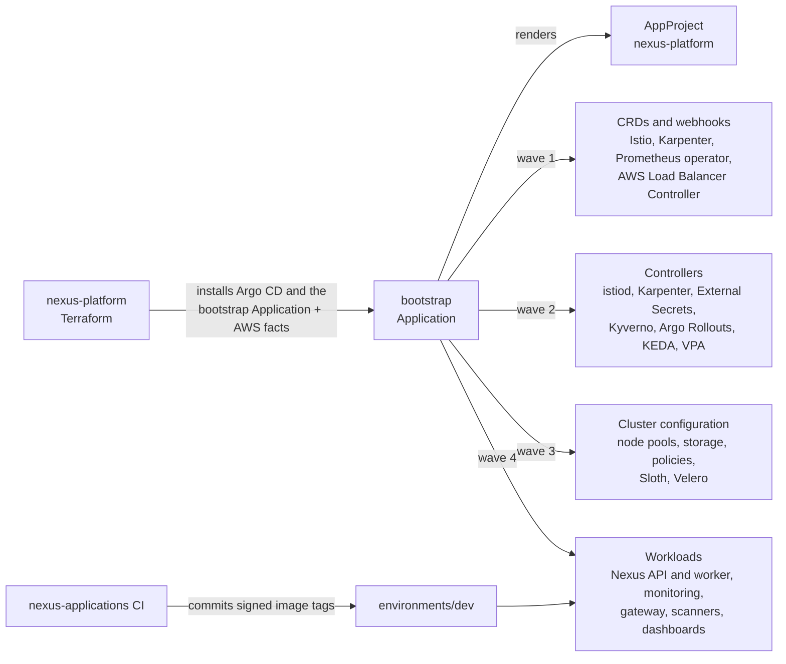

# Nexus GitOps

Everything that runs inside the Nexus Kubernetes clusters: the service mesh,
autoscaling, admission policies, monitoring, backups, and the two Nexus
services. Argo CD in each cluster reads this repository and keeps the cluster
in the state it describes. Nothing here is applied by hand.

## About Nexus

Nexus is a project I built to run a production-style platform on AWS from
start to finish: the infrastructure, the Kubernetes platform on top of it, and
two small services that use all of it. The services are deliberately simple;
the platform around them is the point. The work is split into three
repositories, the way a team would split ownership:

| Repository | What it holds |
| --- | --- |
| [nexus-platform](https://github.com/SergeAbroyan/nexus-platform) | AWS infrastructure with Terraform and Terragrunt |
| **nexus-gitops** (this one) | Everything that runs inside Kubernetes, deployed by Argo CD |
| [nexus-applications](https://github.com/SergeAbroyan/nexus-applications) | The Go API, the Java worker, and their delivery pipeline |

The environments cost money while they run, so I destroy them when I am not
using them, and a rebuild brings everything in this repository back
automatically. The screenshots below come from the last rebuild, on
9 November 2026. More of them, with the problems I found on the way, are on my
portfolio at
[sergeabroyan.com/projects/nexus](https://sergeabroyan.com/projects/nexus/).

## What I built here

- **One root Application.** `nexus-platform` installs Argo CD and creates a
  single Application, `bootstrap`. Its Helm chart renders the 37 Applications
  of the platform and installs them in four sync waves, so CRDs exist before
  the controllers that use them and controllers before their configuration.
- **Facts from Terraform, not copied values.** Role ARNs, queue URLs, database
  endpoints, and the hostname come from Terraform through the root
  Application, so this repository holds no account-specific values.
- **Safe releases.** Argo Rollouts sends 20% and then 50% of the traffic to a
  new API version while Prometheus measures its success rate, and rolls back
  on its own when the check fails.
- **Only trusted images.** Kyverno admits a Nexus image only when the
  `nexus-applications` CI workflow on `main` signed it with cosign, and
  rejects Nexus workloads that run as root, keep Linux capabilities, or have
  no resource limits.
- **A secure mesh.** Istio sidecars with strict mutual TLS between the Nexus
  services, and External Secrets that read every secret from AWS Secrets
  Manager.
- **Scaling on real demand.** Karpenter adds and removes nodes, KEDA scales the
  worker on the depth of its SQS queue, and Goldilocks recommends CPU and
  memory requests from measured use.
- **Observability.** Prometheus, Grafana, Loki, Tempo, and Pyroscope behind
  OpenTelemetry collectors, two service-level objectives turned into burn-rate
  alerts by Sloth, an uptime probe through CloudFront, OpenCost, and alerts by
  email through SNS.
- **Backups and runbooks.** Velero backs up the application, database tool,
  and monitoring namespaces every night, runbooks cover the application,
  platform, and AWS alerts, and eight drills rehearse the failures that
  matter.

## How it works



A change to anything in the clusters is a pull request here. Once it is merged
to `main`, Argo CD applies it within a few minutes. New versions of the Nexus
services arrive the same way: CI in `nexus-applications` commits the image tag
it just built and signed to `environments/dev/`, and its `Deploy` workflow
promotes the same tag to `staging` and `production`.

## See it running

| | |
| --- | --- |
|  |  |
| The 37 Applications after a rebuild from empty | A canary release that passed its analysis and was promoted |
|  |  |
| Every running pod passes the Kyverno policies | The Nexus overview during a 15-minute load test |

## Using it

There is nothing to deploy from this repository on its own. Follow
[Getting started](https://github.com/SergeAbroyan/nexus-platform/blob/main/docs/getting-started.md)
in `nexus-platform`: it creates the cluster, installs Argo CD, and points it at
this repository. If you fork the three repositories, keep their names, because
the infrastructure builds the repository addresses from your GitHub owner and
these names.

Every pull request is checked without a cluster: the workflow renders every
Application exactly as Argo CD would, validates the output against the
Kubernetes and CRD schemas, and runs the Kyverno policies against the Nexus
charts. To render one environment locally:

```bash
helm template bootstrap bootstrap --namespace argocd \
  --values bootstrap/ci-values.yaml \
  --set cluster.environment=dev
```

[Validation](docs/validation.md) shows how to render a single Application with
the values Argo CD would give it.

## What went wrong along the way

Building and rebuilding the platform found real problems, and each one is
fixed in code. A few from this repository:

- With no metrics, the canary's success-rate query fell back to a constant of
  one, so every release would have passed, even a broken one.
- Alertmanager's default email subject grew past the 100 characters SNS
  accepts, so not a single alert email was ever delivered until I shortened
  it and sent a test alert through to the inbox.
- The trace collector replaced the chart's configuration without a telemetry
  reader, so Prometheus reported it as down while traces kept flowing.

The full list, with causes, fixes, and lessons, is at
[sergeabroyan.com/incidents](https://sergeabroyan.com/incidents/).

## Repository layout

```text
bootstrap/        The root chart: the list of add-ons, their versions, and how
                  Terraform's facts reach each one
addons/           Values for third-party Helm charts: Istio, Karpenter, Kyverno,
                  monitoring, and the rest
charts/
├── base/         Library chart with shared, secured resource templates
├── applications/ The Nexus API, the worker, and their runtime: mesh policy,
│                 alerts, dashboards, service-level objectives
└── platform/     Small charts of my own: node pools, storage, policies, the
                  ingress gateway, Cloudflare Tunnel, CloudBeaver
environments/     Values per environment, including the image tags in use
docs/             Guides, runbooks, and decision records
```

## Documentation

| Page | Contents |
| --- | --- |
| [Architecture](docs/architecture.md) | Repository structure, how Argo CD deploys a cluster, sync waves, cluster facts, where each value lives |
| [Workloads](docs/workloads.md) | The Nexus applications and the platform charts |
| [Operations](docs/operations.md) | Deployments, common changes, backups, dashboards and tools |
| [Observability](docs/observability.md) | Metrics, logs, traces, profiles, SLOs, and alerts |
| [Security](docs/security.md) | Admission policies, image scanning, mutual TLS, and secrets |
| [Validation](docs/validation.md) | Checks that run before a change reaches a cluster |
| [Runbooks](docs/runbooks/README.md) | What to do when an alert fires |
| [Decision records](docs/adr/README.md) | Why each major choice was made |
